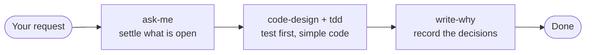
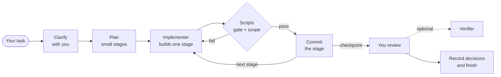

<div align="center">

# 🏭 ai-factory

**Small skills and subagents that take a coding agent from a vague prompt to code you can trust.**

Each one targets a single way agents go wrong, and stays only if evaluations show it helps.

[](LICENSE)
[](https://claude.com/claude-code)
[](docs/measurements.md)

[Quick start](#-quick-start) · [What you get](#-what-you-get) · [Two ways to work](#-two-ways-to-work) · [Evidence](#-how-we-know-it-works)

</div>

---

## 🤔 The problem

An agent is at its most dangerous when it sounds sure of itself. It fills the gaps in your request with guesses, builds on top of them and reports success.

| Without ai-factory | With ai-factory |
|---|---|
| Guesses what you left unsaid | Brings you every open decision before writing code |
| Writes code first, tests maybe | Writes the test first and sees it fail |
| Adds layers and abstractions nobody asked for | Keeps just enough architecture |
| Leaves no trace of why it chose something | Records the decisions the code can't explain |
| One long session that drifts | Small stages, checked by scripts, with stops for your review |

The usual answer is more process around the agent. This project goes the other way, with short skills the agent picks up by itself when they are needed.

## 🚀 Quick start

The kit installs in [Claude Code](https://claude.com/claude-code) as one plugin. In a session:

```
/plugin marketplace add edezacas/ai-factory
/plugin install ai-factory@edezacas
```

It is active right away. Now ask for something a little vague:

```
Add a CSV export for orders
```

Instead of guessing the columns, the date format and who may export, the agent explores the code and comes back with concrete questions. If a skill doesn't start by itself, ask for it by name: `Use the ask-me skill`.

To get a new version, update from `/plugin`, or turn on auto-update for this marketplace there.

## 📦 What you get

### Skills

They activate on their own from what you ask. Only `delegate` waits to be invoked.

| | Skill | Steps in when | What it does |
|---|---|---|---|
| 💬 | [**ask-me**](skills/productivity/ask-me/SKILL.md) | A request leaves something undecided | Interviews you with concrete proposals, so nothing is forgotten and nothing is decided on your behalf |
| 🧪 | [**tdd**](skills/engineering/tdd/SKILL.md) | Code adds or changes behaviour | Writes the test before the code and sees it fail. Tests come from your requirements and check what the code does, not how |
| 📐 | [**code-design**](skills/engineering/code-design/SKILL.md) | Code adds or changes behaviour | Keeps each concern in its place without new layers, no abstraction with a single implementation, operations safe to repeat |
| 📝 | [**write-why**](skills/productivity/write-why/SKILL.md) | The work is finished and verified | Records the decisions that are hard to reverse or surprising, and writes nothing if none qualifies |
| 🗂️ | [**delegate**](skills/productivity/delegate/SKILL.md) | You invoke `/ai-factory:delegate <task>` | Runs the whole task in order: clarify, plan, build in stages with subagents, check, stop for review |
| ⚙️ | [**init-project**](skills/productivity/init-project/SKILL.md) | You set up agent files for a project | Writes `AGENTS.md` and makes `CLAUDE.md` a symbolic link to it |
| 🅰️ | [**angular-conventions**](skills/stack/angular-conventions/SKILL.md) | You touch Angular code | Standalone components, signals, `inject()` and the new control flow |
| ⚡ | [**web-performance**](skills/performance/web-performance/SKILL.md) | A web app feels slow | Measures before and after every optimization |

### Subagents

| | Agent | Launched by | What it does |
|---|---|---|---|
| 🔨 | [**implementer**](agents/implementer.md) | `delegate`, once per stage | Builds one stage from its task file, in TDD, touching only the files the task lists. Runs on Sonnet and carries `tdd` and `code-design` |
| 🔍 | [**verifier**](agents/verifier.md) | You, when you ask for a verification | Checks a finished change against its criteria from empty context, tries the cases no test covers, and changes nothing. Runs on your session's model |

## 🧭 Two ways to work

### Hands-on

You work with the agent in one session and each skill steps in at its moment. Nothing to invoke.



### Delegate

You invoke `/ai-factory:delegate <task>` and the session works in order. It keeps the whole analysis, and each stage goes to an `implementer` that starts from empty context with only what its task needs.



The work stays on its own branch with one commit per stage, and you merge it. `delegate` needs a `harness.json` at the project root with the gate's steps, and proposes one if there is none. It never merges, never pushes and never starts on its own.

### Which one?

| | Hands-on | Delegate |
|---|---|---|
| **You** | Follow the work as it happens | Take part in the analysis, then review at checkpoints |
| **Good for** | A limited quota, quick changes | Order and traceability, work that spans sessions |
| **Cost** | Baseline | About 2.3 times on a task that fits one session, about twice on a large one |
| **Quality** | Baseline | The same: equal results on hidden tests and seeded errors |
| **Main session** | Measured on Sonnet and Opus | Your strongest model. Every figure here was measured with Opus |

## 📊 How we know it works

Instructions that read well don't always change what an agent does, so every piece is tested. Each task runs several times, with the piece and without it.

| Piece | Without it | With it |
|---|---|---|
| `ask-me`, on two vague requests | Its first description triggered in 1 of 10 runs | 10 of 10 after rewording, and it stays out of a rename and a question |
| `tdd`, on two small coding tasks | No tests in 10 of 10 runs | Tests in 10 of 10 |
| `code-design`, a webhook nobody said could be redelivered | Deduplicated in 1 of 10 | 10 of 10 |
| `init-project`, on `/init` | `AGENTS.md` with `CLAUDE.md` linked in 0 of 9 | 9 of 9 |
| `angular-conventions`, on review | `effect()`, `@empty` and `inject()` in 0 of 3 | 3 of 3 |

The `verifier` has no "without" side, so it is tested on its own. Given a change with an error hidden under a green test suite, it failed the change in 3 of 3 runs and named the broken criterion. Given the correct change it passed it in 3 of 3, and it left the working tree untouched every time.

Three things are measured in every run.

- **Quality.** A judge model checks the assertions. Shell commands check what a command can decide, such as hidden tests the agent never saw and seeded errors its tests should catch.
- **Activation.** Did the agent pick up the skill when it should, and leave it alone when it shouldn't?
- **Efficiency.** Turns, tool calls, tokens, cache use, peak context and cost.

### What we don't know yet

- Few runs separate clearly, so a real project may behave differently. The skills were also tried on five tasks in real projects.
- `web-performance` has no numbers. Its work is measuring in a browser before and after each change, which these runs cannot check.
- The `implementer` is told to stop when its task leaves a behaviour open. It stops in about 3 runs of 10 and otherwise makes a choice and reports it as open. The analysis before the plan is what catches these gaps, in 3 of 3 runs.
- The `verifier` is measured on a small change only.

Every figure, with its iteration and model, is in [docs/measurements.md](docs/measurements.md).

<details>
<summary><b>Run an evaluation yourself</b></summary>

<br/>

You need Node 20.11 or later and the Claude Code CLI. It uses your Claude Code account, so each run has a real cost.

```bash
node evals/run.mjs --only ask-me --id 6 --runs 1
```

Results land in `evals/workspace/iteration-N/`. The runner's options and gotchas are in [AGENTS.md](AGENTS.md).

</details>

## 🧱 Principles

- **One skill, one problem.** If it needs an "and" to explain, it's two skills.
- **Short.** The goal and the constraints, not steps a good model already knows.
- **Discovered, not summoned.** A skill's description should get it used at the right moment, without anyone asking. `delegate` is the one exception, because it is a way of working you choose.
- **Measured, or removed.** A piece stays only if the numbers show it helps, or if its work cannot be measured here and that is said.

## 📚 Go deeper

| | |
|---|---|
| [docs/brief.md](docs/brief.md) | What is built and the reason behind each decision |
| [docs/measurements.md](docs/measurements.md) | Every measured result |
| [PLAN.md](PLAN.md) | What is left, and what was left out and why |
| [AGENTS.md](AGENTS.md) | How the repo is laid out and how to run the evals |

## 🙏 Credits

The interview approach owes a lot to [Matt Pocock's skills](https://github.com/mattpocock/skills) and to [skill-factory](https://github.com/eferro/skill-factory) by eferro.

## License

[MIT](LICENSE)
